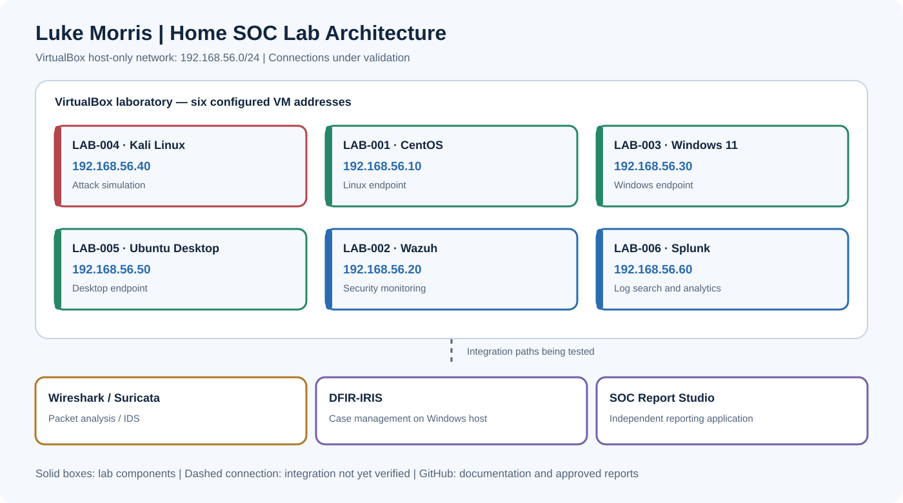

# Home SOC Lab Architecture

## Purpose

This isolated VirtualBox environment supports defensive security practice: generating controlled test activity, collecting endpoint and network telemetry, investigating alerts, and writing evidence-based reports.

## VM inventory

| ID | System | Host-only IP | Intended role |
|---|---|---|---|
| LAB-001 | CentOS | `192.168.56.10` | Linux endpoint |
| LAB-002 | Ubuntu Server / Wazuh | `192.168.56.20` | Endpoint monitoring and alerting |
| LAB-003 | Windows 11 | `192.168.56.30` | Windows endpoint |
| LAB-004 | Kali Linux | `192.168.56.40` | Controlled attack simulations |
| LAB-005 | Ubuntu Desktop | `192.168.56.50` | Desktop endpoint |
| LAB-006 | Ubuntu Server / Splunk | `192.168.56.60` | Log search and analysis |

**Network:** `192.168.56.0/24` (VirtualBox host-only). **DFIR-IRIS** runs on the Windows host through Docker Desktop, rather than as an additional VM. **Wireshark** supports packet inspection; **Suricata** provides network intrusion detection. **SOC Report Studio** is a separate reporting application under development.

## Data flow (target design)

1. Generate authorized lab activity from Kali or endpoints.
2. Capture traffic with Wireshark and validate Suricata's visibility.
3. Collect endpoint and detection events in Wazuh; investigate additional records in Splunk.
4. Track the case and supporting artifacts in DFIR-IRIS.
5. Bring selected case and alert evidence into SOC Report Studio, review a report, then publish approved materials to GitHub.

## Validation status

The six host-only addresses are established. Luke has observed VM traffic with Wireshark. End-to-end Suricata, Wazuh, Splunk, and DFIR-IRIS integrations remain **under configuration / not yet independently verified**. This page will be updated as each connection is tested.

## Design principles

- Keep simulated activity isolated to the lab.
- Separate observed facts from planned integrations.
- Preserve original timestamps, source IDs, and evidence references.
- Publish sanitized screenshots and reports; never publish API tokens or secrets.
